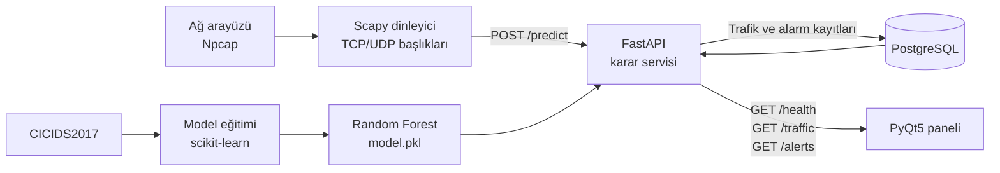

# Yapay Zeka Destekli Ağ Anomali Tespit Sistemi

Canlı TCP/UDP trafiğini paket yükünü okumadan inceleyen savunma amaçlı bir
saldırı tespit sistemidir (IDS). Ağ başlıklarından çıkarılan özellikler Random
Forest modeliyle sınıflandırılır, sonuçlar PostgreSQL'e kaydedilir ve PyQt5
masaüstü panelinde gösterilir. Sistem trafiği engellemez.

## Mimari akış



Çalışma zamanında Scapy dinleyicisi ve PyQt5 paneli ana bilgisayarda çalışır.
FastAPI ile PostgreSQL servisleri Docker Compose tarafından yönetilir.

## Kullanılan teknolojiler

- **Scapy:** Ağ arayüzündeki IPv4 TCP/UDP paket başlıklarını yakalar ve model
  girdilerini üretir.
- **FastAPI:** Tahmin, sağlık, trafik ve alarm uçlarını sunar.
- **PostgreSQL:** Trafik sınıflandırmalarını ve tehdit alarmlarını kalıcı olarak
  saklar.
- **Docker ve Docker Compose:** FastAPI ile PostgreSQL servislerini tekrarlanabilir
  bir ortamda ayağa kaldırır.
- **PyQt5:** Canlı güvenli trafik ve tehdit kayıtlarını gösteren masaüstü
  panelini sağlar.
- **scikit-learn:** CICIDS2017 verisiyle dört sınıflı Random Forest modelini
  eğitir.

## Gereksinimler

- Python 3.11 veya 3.12
- Docker Desktop ve Docker Compose
- Windows için **Npcap (zorunlu)**
- Paket yakalama için yönetici yetkisi

> [!IMPORTANT]
> Windows'ta Scapy ile canlı paket yakalamak için
> [Npcap](https://npcap.com/#download) kurulmuş olmalıdır. Kurulum sırasında
> **Install Npcap in WinPcap API-compatible Mode** seçeneğini işaretleyin ve
> dinleyiciyi ya da paneli yönetici olarak çalıştırın.

## Yerel kurulum

Depoyu klonladıktan sonra proje dizininde:

```powershell
python -m venv venv
.\venv\Scripts\Activate.ps1
pip install -r requirements.txt
```

Örnek ortam dosyasını kopyalayın ve `.env` içindeki PostgreSQL parolasını
değiştirin. `.env` dosyası Git tarafından yok sayılır; gerçek parolaları
`.env.example` içine yazmayın.

```powershell
Copy-Item .env.example .env
```

Model henüz oluşturulmadıysa veri kümesini indirip modeli eğitin:

```powershell
python -m training.download_dataset
python -m training.train
```

Veri indirme betiği varsayılan olarak UNB CICIDS2017 CSV dosyalarının herkese
açık Parquet aynasını kullanır. Resmî ZIP yeniden erişilebilir olduğunda
`--source official-zip` seçilebilir.

## Docker ile API ve veritabanını başlatma

Docker Desktop çalışırken proje kökünde şu komutu çalıştırın:

```powershell
docker-compose up --build
```

Sonraki çalıştırmalarda imajı yeniden oluşturmak gerekmiyorsa doğrudan
`docker-compose up` komutu kullanılabilir.

- Sağlık kontrolü: <http://127.0.0.1:8000/health>
- OpenAPI arayüzü: <http://127.0.0.1:8000/docs>

Model dosyası yoksa servis açılmaz; modeli eğittikten sonra Docker imajını
yeniden oluşturun. Model yüklenemezse servis `not_ready` durumunda kalır ve
`/predict` ucu HTTP 503 döndürür.

## Dinleyiciyi çalıştırma

PowerShell'i **yönetici olarak** açın. Kullanılabilir ağ arayüzlerini listeleyin:

```powershell
python -c "from scapy.all import get_if_list; print(get_if_list())"
```

Ardından trafiği FastAPI servisine göndererek dinleyiciyi başlatın:

```powershell
python sniffer.py --iface "ARAYUZ_ADI" --output http
```

API olmadan üretilen JSON kayıtlarını görmek için `--output stdout`
kullanılabilir. `SNIFFER_INTERFACE`, `SNIFFER_OUTPUT` ve `IDS_API_URL` ortam
değişkenleri de desteklenir.

## Masaüstü paneli

API ve veritabanı çalışırken:

```powershell
python -m dashboard.main
```

Panel API'yi 1,5 saniyede bir yeniler ve dinleyiciyi seçilen yerel ağ
arayüzünde başlatıp durdurabilir.

## Testler

```powershell
pytest
```

Kali/Ubuntu kabul adımları ve saha kontrolleri
[`docs/acceptance.md`](docs/acceptance.md) dosyasındadır.
