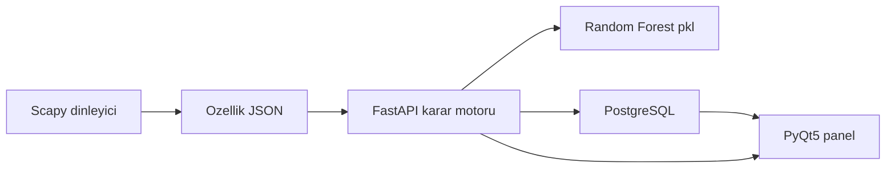

# Yapay Zeka Destekli Ağ Anomali Tespit Sistemi — İsterler

## 1. Amaç

Sistem, ağ arayüzünden geçen TCP ve UDP trafiğini canlı izleyen bir saldırı tespit sistemidir (IDS). Karar, statik imza kurallarına değil eğitilmiş bir makine öğrenmesi modeline dayanır. Amaç, daha önce görülmemiş (zero-day) saldırıları ve normal görünümlü sinsi taramaları davranış örüntülerinden ayırt etmek, bunları kaydetmek ve masaüstü panelde göstermek.

Sistem savunma amaçlıdır. Tespit edilen trafiği engellemez; uyarır ve kaydeder.

## 2. Kapsam

### 2.1 Kapsam içi

- Seçilen ağ arayüzünden canlı TCP/UDP paket başlıklarının dinlenmesi
- Paket başlıklarından özellik çıkarımı ve JSON sözleşmesine dönüştürülmesi
- Eğitilmiş model ile sınıflandırma: Temiz, DDoS, Brute Force, Port Scan
- Tüm trafiğin ve tehdit kararlarının PostgreSQL’e yazılması
- PyQt5 panelinde güvenli akışın ve tehditlerin ayrı gösterilmesi
- FastAPI karar motoru ile PostgreSQL’in Docker ile ayağa kaldırılması
- Yetkili laboratuvar ağında tespit doğrulaması

### 2.2 Kapsam dışı

- Paket düşürme, bağlantı kesme veya otomatik engelleme (IPS davranışı)
- İmza veritabanı ve kural motoru
- Bulutta çok kiracılı dağıtım
- Şifreli yük (payload) içeriğinin çözülmesi; karar yalnızca başlık özelliklerine dayanır
- Modelin üretimde otomatik yeniden eğitilmesi

## 3. Mimari akış

1. **Paket dinleme.** Scapy, seçilen Wi-Fi veya Ethernet arayüzünden TCP/UDP paketlerini canlı yakalar.
2. **Özellik çıkarımı.** Boyut, gönderim sıklığı, SYN ve ACK bayrakları ile port numaraları ayrıştırılır ve eğitim veri setindeki alanlara uyumlu JSON üretilir.
3. **Çıkarım.** JSON, Pydantic ile doğrulanır ve FastAPI üzerinden `.pkl` Random Forest modeline iletilir.
4. **Kayıt ve uyarı.** Tüm trafik ile tehdit olarak sınıflanan kayıtlar PostgreSQL’e yazılır. Tehditler PyQt5 panelinde canlı uyarı olarak görünür.

Dinleyici ve panel, karar motoruna HTTP ile bağlanır. Model dosyası karar motorunun yanında yüklenir; panel modeli doğrudan çağırmaz.

## 4. Teknoloji kararları

| Katman | Seçim | Gerekçe |
| --- | --- | --- |
| Dil ve veri işleme | Python, Pandas | Veri seti hazırlığı, özellik çerçevesi ve servis kodu tek dilde kalır |
| Model | Scikit-learn Random Forest, dışa aktarım `.pkl` | Çıktı çok sınıflıdır: Temiz, DDoS, Brute Force, Port Scan. CICIDS2017 ve UNSW-NB15 etiketli olduğundan denetimli model kullanılır |
| Karşılaştırma notu | Isolation Forest | Denetimsiz anomali skoru için yedek olarak belgelenir; ilk sürümün karar motoru değildir |
| Ağ dinleme | Scapy | Arayüzden canlı paket başlığı yakalamak için |
| Karar servisi | FastAPI | Model çıkarımını HTTP ile sunmak için |
| Doğrulama | Pydantic | Gelen paket JSON’unun şemaya uymasını zorunlu kılar |
| Veritabanı | PostgreSQL | Backend ile birlikte konteynerde ayağa kalkar. SQLite bu dağıtım modeline alınmaz |
| Panel | PyQt5 | Canlı trafik listesi ve tehdit tablosu için masaüstü kontrol paneli |
| Dağıtım | Docker | FastAPI servisi ve PostgreSQL izole çalışır |
| Laboratuvar | Kali Linux veya Ubuntu | Dinleme ve yetkili tespit testi bu ortamlarda yapılır |
| Geliştirme | Cursor IDE | Uygulama kodunun yazıldığı ortam |

## 5. Fonksiyonel isterler

### 5.1 Eğitim ve model

- **F-01.** Sistem, CICIDS2017 veya UNSW-NB15 içinden normal trafik ile saldırı trafiğini birlikte kullanan bir eğitim kümesi hazırlar.
- **F-02.** Etiketler dört karara indirilir: `Temiz`, `DDoS`, `Brute Force`, `Port Scan`. Kaynak veri setindeki alt türler bu dört etikete eşlenir; eşleme tablo halinde belgelenir.
- **F-03.** Eğitilen Random Forest modeli tek bir `.pkl` dosyası olarak dışa aktarılır. Karar motoru bu dosyayı açılışta yükler.
- **F-04.** Eğitim adımı doğruluk, kesinlik, duyarlılık ve F1 değerlerini sınıf bazında raporlar. Rapor, model dosyasıyla birlikte saklanır.

### 5.2 Dinleme ve özellik çıkarımı

- **F-05.** Dinleyici, yapılandırmada verilen tek bir ağ arayüzünü dinler. Arayüz adı ortam değişkeni veya yapılandırma dosyasıyla verilir.
- **F-06.** Yalnızca TCP ve UDP paketleri işlenir. Diğer protokoller sayaçta tutulur ve modele gönderilmez.
- **F-07.** Her işlenen paket için en az şu alanlar üretilir: zaman damgası, protokol, kaynak ve hedef IP, kaynak ve hedef port, paket boyutu, ilgili pencere içindeki gönderim sıklığı, SYN bayrağı, ACK bayrağı.
- **F-08.** Özellik kaydı, bölüm 7’deki JSON sözleşmesine uyar ve karar motoruna HTTP ile gönderilir. Yük (payload) içeriği iletilmez.

### 5.3 Karar motoru

- **F-09.** Karar motoru, doğrulanmış özellik JSON’unu alır ve modelden sınıf etiketi ile tehdit kararını döner.
- **F-10.** `Temiz` dışındaki her sınıf `Tehdit` kabul edilir. Yanıt hem ikili kararı (`Temiz` veya `Tehdit`) hem sınıf adını içerir.
- **F-11.** Şemaya uymayan istek 422 ile reddedilir ve veritabanına trafik kaydı olarak yazılmaz.
- **F-12.** Model dosyası yoksa veya yüklenemezse servis hazır olmayan durumda kalır; panel bu durumu ayrıca gösterir.

### 5.4 Kayıt

- **F-13.** Modelin işlediği her paket, karar ve sınıf ile birlikte trafik tablosuna yazılır.
- **F-14.** `Tehdit` kararı alan kayıtlar ayrıca uyarı tablosuna yazılır. Uyarı; zaman, sınıf, kaynak, hedef, port ve karar anındaki özellikleri taşır.
- **F-15.** Kayıtlar silinmeden listelenir. Panel, son kayıtları zaman sırasıyla okur.

### 5.5 Panel

- **F-16.** Panel, arka plandaki dinleyici ve karar motorunun durumunu (çalışıyor, durdu, hazır değil) gösterir.
- **F-17.** Güvenli trafik, yeşil vurgulu ve akan bir listede gösterilir. Liste en yeni kayıt üstte olacak şekilde güncellenir.
- **F-18.** Tehditler ayrı bir tabloda, kırmızı vurgu ile gösterilir. Tabloda zaman, sınıf, kaynak IP, hedef IP ve hedef port yer alır.
- **F-19.** Panel veriyi PostgreSQL ve karar motorundan okur. Sınıflandırmayı panel içinde yeniden hesaplamaz.

## 6. Fonksiyonel olmayan isterler

- **NF-01.** Karar motoru ve PostgreSQL, Docker Compose ile tek komutla ayağa kalkar. Panel ve dinleyici laboratuvar makinesinde, ağ arayüzüne erişecek şekilde çalışır.
- **NF-02.** Paket JSON’u Pydantic modeli dışında servise kabul edilmez.
- **NF-03.** Veritabanı bağlantı bilgisi kod içine yazılmaz; ortam değişkeninden okunur.
- **NF-04.** Panel, yeni kayıtları en geç 2 saniye içinde listelere yansıtır.
- **NF-05.** Karar uç noktası, tek paket özelliği için laboratuvar koşullarında 200 ms içinde yanıt döner. Bu süre model yüklemesini kapsamaz.
- **NF-06.** Dinleme yalnızca operatörün seçtiği arayüzde ve operatörün yetkili olduğu ağda yapılır.
- **NF-07.** Loglarda parola, bağlantı cümlesi ve paket yükü bulunmaz.

## 7. Veri ve API sözleşmesi

### 7.1 Özellik JSON’u

Karar isteğinin gövdesi:

| Alan | Tür | Anlamı |
| --- | --- | --- |
| `timestamp` | ISO-8601 metin | Paketin yakalandığı an |
| `protocol` | `TCP` veya `UDP` | Taşıma protokolü |
| `src_ip` | metin | Kaynak adres |
| `dst_ip` | metin | Hedef adres |
| `src_port` | tamsayı | Kaynak port |
| `dst_port` | tamsayı | Hedef port |
| `packet_size` | tamsayı | Paket boyutu (bayt) |
| `send_rate` | sayı | Aynı kaynak için kısa penceredeki gönderim sıklığı |
| `syn` | mantıksal | SYN bayrağı var mı |
| `ack` | mantıksal | ACK bayrağı var mı |

UDP kayıtlarında bayrak alanları `false` gönderilir.

### 7.2 Karar yanıtı

| Alan | Tür | Anlamı |
| --- | --- | --- |
| `verdict` | `Temiz` veya `Tehdit` | İkili karar |
| `label` | metin | `Temiz`, `DDoS`, `Brute Force`, `Port Scan` |
| `id` | tamsayı | Yazılan trafik kaydının kimliği |

### 7.3 Uç noktalar

| Yöntem | Yol | İş |
| --- | --- | --- |
| `GET` | `/health` | Modelin yüklü ve veritabanının erişilebilir olduğunu bildirir |
| `POST` | `/predict` | Özellik JSON’unu sınıflar, kaydeder, karar döner |
| `GET` | `/traffic` | Son trafik kayıtlarını, güvenli olanlar süzülebilir şekilde listeler |
| `GET` | `/alerts` | Tehdit uyarılarını yeniden eskiye listeler |

Sayfalama `limit` sorgu parametresi ile yapılır. Varsayılan limit 100, üst sınır 500’dür.

### 7.4 Tablolar

**traffic:** `id`, `captured_at`, `protocol`, `src_ip`, `dst_ip`, `src_port`, `dst_port`, `packet_size`, `send_rate`, `syn`, `ack`, `verdict`, `label`.

**alerts:** `id`, `traffic_id`, `captured_at`, `label`, `src_ip`, `dst_ip`, `dst_port`. Yalnızca `Tehdit` kayıtları için satır açılır.

## 8. Arayüz isterleri

- Üst şerit: dinleyici durumu, karar motoru durumu, seçili arayüz adı.
- Sol veya ana alan: güvenli trafik listesi, satır zemini yeşil.
- Sağ veya alt alan: tehdit tablosu, satır zemini kırmızı.
- Boş durumda her iki liste “kayıt yok” metnini gösterir; hata durumunda servis mesajı şeritte kalır, liste eski veriyi silmez.

## 9. Geliştirme aşamaları

### Aşama 1 — Veri seti ve model eğitimi

CICIDS2017 veya UNSW-NB15 ile F-01 … F-04 tamamlanır. Çıktı: `.pkl` model dosyası, etiket eşleme tablosu ve metrik raporu.

### Aşama 2 — Ağ dinleme modülü

Scapy ile F-05 … F-08 tamamlanır. Çıktı: seçilen arayüzü dinleyip özellik JSON’u üreten betik. Karar motoru yokken JSON’u dosyaya veya standart çıktıya yazabilmelidir.

### Aşama 3 — Karar motoru ve kayıt

FastAPI, Pydantic ve PostgreSQL ile F-09 … F-15 tamamlanır. Çıktı: `/health`, `/predict`, `/traffic`, `/alerts` ve iki tablo.

### Aşama 4 — Güvenlik paneli

PyQt5 ile F-16 … F-19 ve bölüm 8 tamamlanır. Çıktı: akan yeşil liste ve kırmızı tehdit tablosu.

### Aşama 5 — Konteyner ve laboratuvar kabulü

FastAPI ile PostgreSQL Docker Compose üzerinde ayağa kalkar (NF-01). Kabul, bölüm 10’daki senaryolarla yapılır.

## 10. Kabul kriterleri

Testler, operatörün yetkili olduğu laboratuvar ağında ve Kali Linux veya Ubuntu üzerinde yapılır. Amaç, sistemin tespiti kayda ve panele düşürüp düşürmediğini doğrulamaktır.

- **K-01.** Sağlık ucu, model yüklü ve veritabanı erişilebilir iken hazır yanıtı döner.
- **K-02.** Şemaya uyan bir özellik JSON’u `/predict` ile sınıflanır ve `traffic` tablosunda görünür.
- **K-03.** Eksik alanlı istek 422 döner ve tabloya yazılmaz.
- **K-04.** Laboratuvar ağında yapılan bir port tarama, `Port Scan` tehdidi olarak `alerts` tablosuna ve paneldeki kırmızı tabloya düşer.
- **K-05.** Laboratuvar ağında yapılan küçük ölçekli bir SYN flood simülasyonu, `DDoS` tehdidi olarak `alerts` tablosuna ve paneldeki kırmızı tabloya düşer.
- **K-06.** Aynı anda akan normal trafik, yeşil listede `Temiz` olarak görünür.
- **K-07.** Tehdit satırı en geç 2 saniye içinde panelde belirir (NF-04).

K-04 ve K-05 yalnızca kendi laboratuvar ağında, tespit doğrulaması için geçerlidir. Bu belge saldırı komutu, aracı parametresi veya istismar adımı içermez.

## 11. Teslim çıktıları

- `isterler.md` (bu belge)
- Eğitim betiği, etiket eşleme tablosu, metrik raporu ve `.pkl` model
- Dinleme betiği
- FastAPI karar motoru ve PostgreSQL şeması
- Docker Compose tanımı
- PyQt5 panel uygulaması
- K-01 … K-07 sonuçlarının kısa test notu
